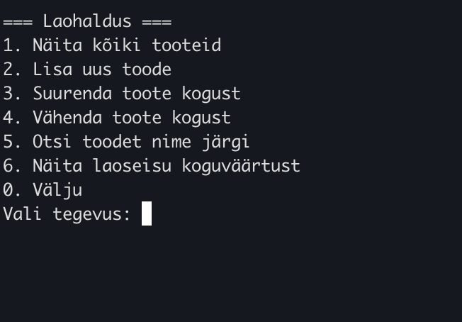
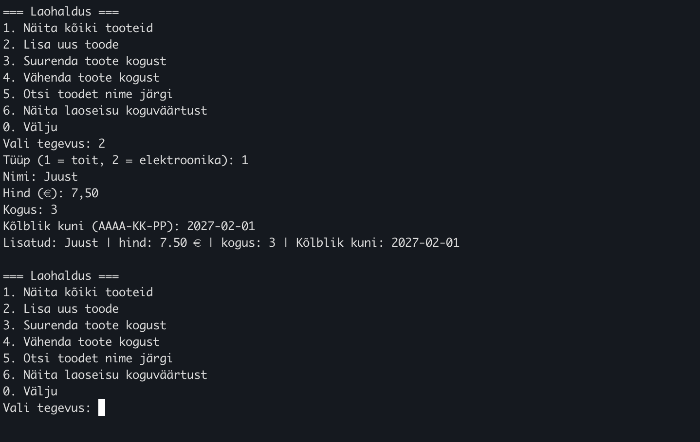
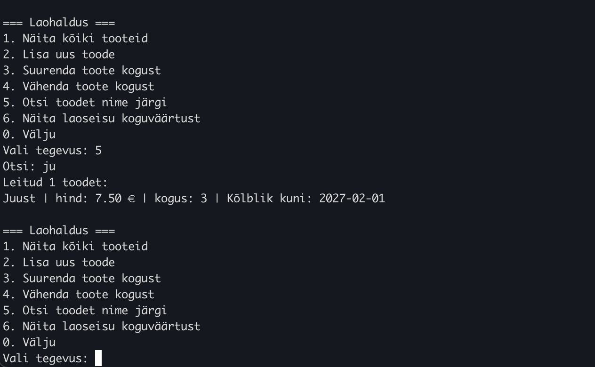
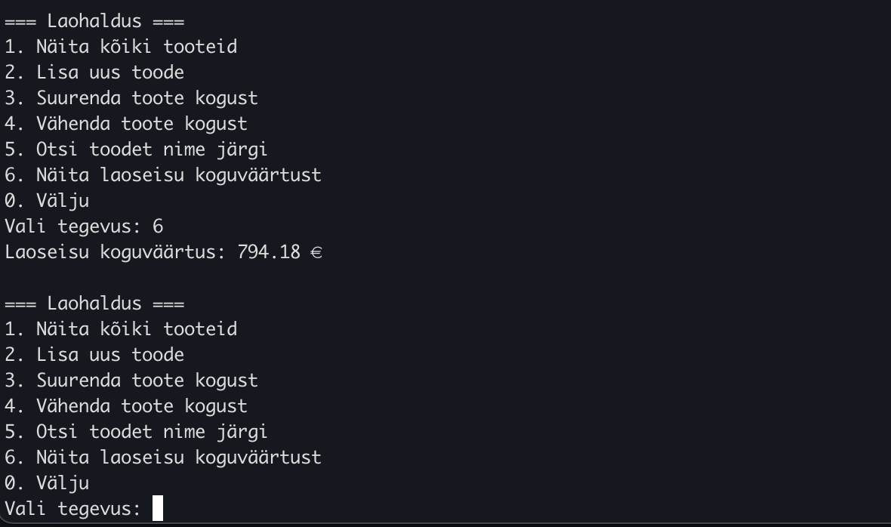

# Mini laohaldusrakendus

Java konsoolirakendus väikese poe laoseisu haldamiseks (TAK25 koolitöö).

## Kiire start

```
./run.sh
```

See kompileerib koodi ja käivitab rakenduse. Skript leiab Homebrew'ga paigaldatud Java ise
üles, isegi kui `java` ei ole PATH-is. Käivitada saab ükskõik millisest kaustast.

Rakendus alustab nelja näidistootega. Menüüst saab tooteid vaadata, lisada, koguseid muuta,
nime järgi otsida ja laoseisu koguväärtust näha.

## Ekraanipildid

Peamenüü:



Uue toidutoote lisamine:



Toote otsimine nime osa järgi:



Laoseisu koguväärtus:



## Testid

```
./run.sh test
```

(sama mis `mvn test`)

## Nõuded

- Java 21 või uuem. Puudumisel: `brew install openjdk@21`
- Maven 3.9 või uuem, ainult testide jaoks (`brew install maven`)

## Käsitsi käivitamine

Kui `run.sh` ei sobi (nt Windows), tee samad sammud käsitsi:

```
mvn -q compile
java -cp target/classes laohaldus.Main
```

## Ülesehitus

| Klass | Roll |
|---|---|
| `Product` | abstraktne toode: nimi, hind, kogus (kapseldatud), abstraktne `getExtraInfo()` |
| `FoodProduct` | toit, lisaväli kõlblikkusaeg |
| `ElectronicProduct` | elektroonika, lisaväli garantii kuudes |
| `Inventory` | hoiab tooteid `LinkedHashMap<String, Product>` struktuuris, võti on nimi väikeste tähtedega |
| `ConsoleMenu` | konsoolimenüü ja kasutaja sisendi töötlus |
| `SampleData` | näidistooted |
| `Main` | paneb osad kokku ja käivitab menüü |
| `run.sh` | käivitab rakenduse või testid ühe käsuga |
